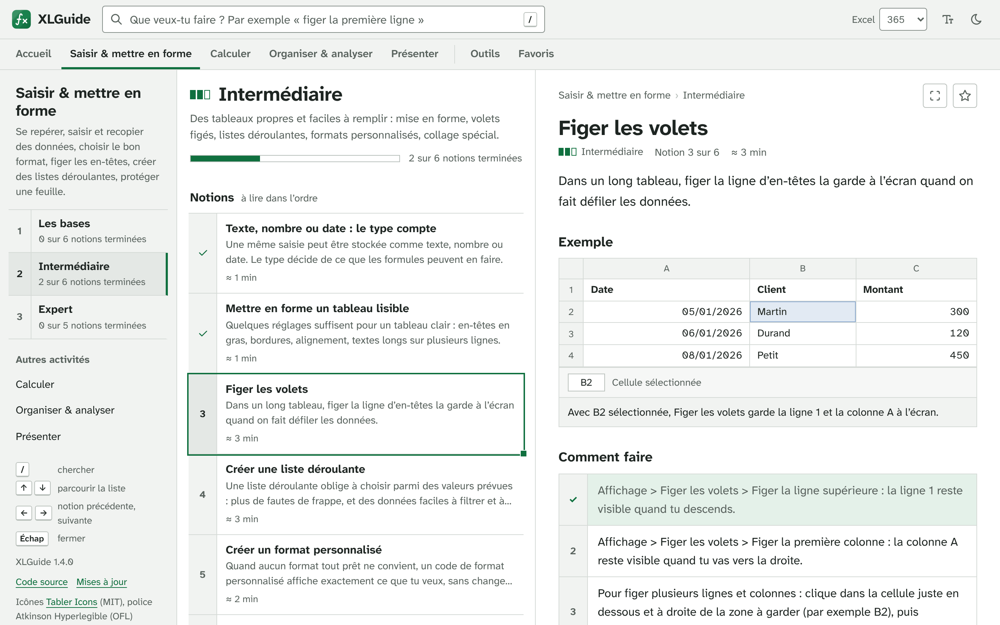

<div align="center">


# XLGuide

**Apprendre à utiliser Excel en français, des bases à l’expert.**

Application gratuite pour **Windows** et **Linux** (et version web) : quatre activités en trois niveaux, des notions courtes avec les étapes à suivre et un mini-tableau d’exemple, et une recherche en langage naturel quand tu cherches quelque chose de précis.

[](https://github.com/Joss943/xlguide/actions/workflows/ci.yml)
[](https://github.com/Joss943/xlguide/releases/latest)
[](LICENSE)

**[Télécharger](https://joss943.github.io/xlguide/#telecharger)**, ouvrir la **[version web](https://joss943.github.io/xlguide/app/)** ou visiter le **[site](https://joss943.github.io/xlguide/)**.



</div>

---

## Ce que fait XLGuide

**Un parcours en 4 activités**, chacune en 3 niveaux (**Les bases → Intermédiaire → Expert**) :

| Activité | Les bases | Intermédiaire | Expert |
|---|---|---|---|
| **Saisir & mettre en forme** | se repérer, saisir, sélectionner, lignes et colonnes, poignée de recopie, formats de nombres et de dates | type des données, mise en forme, figer les volets, listes déroulantes, formats personnalisés, collage spécial | plages nommées, saisie contrôlée par une règle, listes en cascade, protection, texte importé converti en nombres |
| **Calculer** | écrire et recopier une formule, `$`, pourcentages, `SOMME`, `MOYENNE`, `SI` | `SOMME.SI.ENS`, `SI.CONDITIONS`, arrondis, `RECHERCHEV` / `RECHERCHEX`, `#N/A`, dates, heures, texte | `INDEX` + `EQUIV`, plusieurs critères, `SOMMEPROD`, `TEXTE.AVANT` / `TEXTE.APRES`, `DECALER` / `INDIRECT`, `LET` / `LAMBDA` |
| **Organiser & analyser** | tableau structuré, trier et filtrer, rechercher et remplacer, doublons | mise en forme conditionnelle, classements, comparer deux listes, Convertir, TCD, `FILTRE` / `TRIER` / `UNIQUE` | segments, chronologie et champs calculés, Power Query, statistiques, tendance, `PIVOTER.PAR` / `PRENDRE` / `ASSEMB.V` |
| **Présenter** | créer et modifier un graphique, mettre en page et imprimer | choisir le bon graphique, graphique combiné, sparklines, imprimer un grand tableau | graphique croisé dynamique, graphiques spécialisés (cascade, entonnoir…), graphique piloté par une liste, tableau de bord |

- **69 notions** à lire dans l’ordre : les étapes à suivre dans Excel, ce qu’il faut retenir, et un **mini-tableau** où la plage à sélectionner, ou les cellules visées par la formule, sont en couleur.
- **98 fonctions**, des bases à l’expert, chacune rangée dans son activité ; fiches claires : l’essentiel d’abord, puis la syntaxe argument par argument, le reste replié. Pas de spécialité métier (finance, ingénierie) : uniquement l’usage d’Excel.
- **Recherche en langage naturel** : « figer la première ligne », « liste déroulante », « additionner avec une condition »… Tolère accents oubliés, pluriels et fautes de frappe ; accepte aussi les noms anglais (`SUMIFS`, `VLOOKUP`).
- **Outils** : traducteur de formules FR ⇄ EN (il reconnaît aussi les fonctions sans fiche), erreurs (`#N/A`, `#VALEUR!`…), raccourcis clavier (AZERTY), index des fonctions, compatibilité de version (2010 → 365).
- **Pensé pour le TDAH** : une seule action mise en avant (« Commencer », puis « Continuer » là où tu en étais), durée estimée de chaque notion, étapes à cocher, « J’ai compris, notion suivante », progression enregistrée, longues listes repliées, **mode concentration** (la fiche seule, centrée), flèches ← → entre les notions, texte agrandissable, animations coupées si le système le demande.
- **Hors-ligne, privé** : aucune connexion, aucun compte, aucune donnée envoyée. Favoris, mode sombre, navigation au clavier.

**Fiabilité :** chaque résultat affiché (exemples et mini-tableaux, plus de 300 aujourd’hui) est recalculé automatiquement par un tableur indépendant (LibreOffice Calc) dans la CI, et chaque formule passe un aller-retour FR → EN → FR.

## Installation

### Windows 10 / 11

Télécharge [**XLGuide-Setup.exe**](https://github.com/Joss943/xlguide/releases/latest/download/XLGuide-Setup.exe) et lance-le (pas besoin de droits administrateur).

> L’installateur n’est pas signé par un certificat payant : si SmartScreen s’affiche, clique sur **Informations complémentaires → Exécuter quand même**.

Ou en une ligne dans PowerShell :

```powershell
irm https://joss943.github.io/xlguide/install.ps1 | iex
```

### Linux (x86_64)

Une commande qui détecte ta distribution et installe le bon paquet :

```bash
curl -fsSL https://joss943.github.io/xlguide/install.sh | bash
```

Ou manuellement :

| Distribution | Commande |
|---|---|
| **Ubuntu / Debian / Mint / Pop!_OS** | `wget -qO /tmp/xlguide.deb https://github.com/Joss943/xlguide/releases/latest/download/xlguide-amd64.deb && sudo apt install -y /tmp/xlguide.deb` |
| **Fedora / RHEL / Rocky / Alma** | `sudo dnf install -y https://github.com/Joss943/xlguide/releases/latest/download/xlguide-x86_64.rpm` |
| **openSUSE** | `sudo zypper install --allow-unsigned-rpm ./xlguide-x86_64.rpm` |
| **Arch / Manjaro / EndeavourOS** | `curl -fLo /tmp/xlguide.pacman https://github.com/Joss943/xlguide/releases/latest/download/xlguide-x86_64.pacman && sudo pacman -U --noconfirm /tmp/xlguide.pacman` |
| **Autres** | [AppImage](https://github.com/Joss943/xlguide/releases/latest/download/XLGuide-x86_64.AppImage) : `chmod +x XLGuide-x86_64.AppImage && ./XLGuide-x86_64.AppImage` (nécessite FUSE 2) |

Désinstaller : `curl -fsSL https://joss943.github.io/xlguide/install.sh | bash -s -- --uninstall`

### Sans installation

[joss943.github.io/xlguide/app](https://joss943.github.io/xlguide/app/) fonctionne dans n’importe quel navigateur, et s’installe comme une application (Chrome/Edge : icône « Installer » dans la barre d’adresse). Elle reste disponible hors-ligne.

## Utilisation

| Touche | Action |
|---|---|
| <kbd>/</kbd> ou <kbd>Ctrl</kbd>+<kbd>K</kbd> | Aller dans la recherche |
| <kbd>↑</kbd> <kbd>↓</kbd> | Parcourir les résultats (la fiche s’ouvre à droite) |
| <kbd>Entrée</kbd> | Ouvrir le premier résultat |
| <kbd>←</kbd> <kbd>→</kbd> | Notion précédente / suivante |
| <kbd>Échap</kbd> | Effacer la recherche / fermer la fiche |

- Débutant : **Saisir & mettre en forme › Les bases**, notions 1, 2, 3… dans l’ordre, puis **Calculer › Les bases**.
- Clique sur le nom d’une fonction **dans une formule** pour ouvrir sa fiche.
- Colle une formule commençant par `=` dans **Outils › Traducteur**.
- ★ ajoute une fiche à tes favoris (stockés localement).

## Interface

L’interface reprend la feuille de calcul : surfaces blanches, en-têtes gris, quadrillage fin à la place des cartes et des ombres, numéros de ligne pour l’ordre de lecture. Un seul motif fort, le **curseur de sélection d’Excel** (cadre vert et poignée de recopie), signale « tu es ici ». Chaque couleur a un seul sens : vert pour la sélection, la progression et l’action principale, jaune surligneur pour « À retenir », rouge pour les erreurs. La police **Atkinson Hyperlegible**, conçue pour la lecture facile, distingue nettement I, l et 1, O et 0.

## Développement

Prérequis : Node.js 20+.

```bash
git clone https://github.com/Joss943/xlguide && cd xlguide
npm ci
npm start                 # lance l'application de bureau
npm test                  # contenu, traducteur, recherche, rendu de toutes les pages et fiches
npm run dist:linux        # paquets deb, rpm, pacman, AppImage dans dist/
npm run dist:win          # installateur Windows (sous Windows)
npm run site:build        # génère le site GitHub Pages dans _site/
```

Vérifier les résultats des exemples avec LibreOffice (`soffice` + `python3-openpyxl`) :

```bash
npm run verify:formulas
```

### Structure

```
app/                 Application (HTML/CSS/JS sans dépendance) — partagée par le bureau et le web
  data/              Contenu : fonctions, méthodes, erreurs, raccourcis
    parcours.js      Les 4 activités, les 3 niveaux et la place de chaque fonction et méthode
    notions/         Les notions du parcours, un fichier par activité
    samples.js       Mini-tableaux des fiches fonctions et méthodes
  js/config.js       Version et liens publics (lus aussi par Electron)
  js/formula.js      Analyse, coloration, références de cellules et traduction FR ⇄ EN des formules
  js/search.js       Moteur de recherche en langage naturel
  js/core/           Modèle (index du contenu, parcours), progression et stockage local
  js/views/          Vues : fonctions pures données → HTML (accueil, listes, fiches, outils)
  js/app.js          Contrôleur : routage, rendu, événements
  css/               app.css (socle) et parcours.css (niveaux, accueil, fiches, mini-tableaux)
  fonts/             Polices Atkinson Hyperlegible Next et Mono (SIL OFL 1.1)
electron/            Enveloppe bureau (fenêtre sécurisée : sandbox, isolation de contexte)
site/                Site GitHub Pages + scripts d'installation install.sh / install.ps1
scripts/             Génération des icônes et du site
tests/               Tests Node + vérification des résultats via LibreOffice
.github/workflows/   CI, compilation Windows/Linux et release, déploiement du site
```

### Ajouter du contenu

Tout est dans `app/data/`. Une fonction tient en un appel :

```js
F('SOMME.SI', 'SUMIF', 'math', '',                       // nom FR, nom EN, catégorie, version minimale
  'Additionne les valeurs qui répondent à UN critère.',  // description
  'SOMME.SI(plage; critère; [somme_plage])',            // syntaxe
  [['plage', 'Cellules testées.'], ['critère', '…'], ['somme_plage', '…']],
  [['=SOMME.SI(B2:B500;"Fournisseur A";D2:D500)', 'Total des achats chez un fournisseur.'],
   ['=SOMME(10;20;30)', 'Exemple vérifié automatiquement.', 60]],   // 3e valeur = résultat attendu
  ['Astuce…'],
  'mots clés pour la recherche',
  'SOMME.SI.ENS NB.SI');                                // voir aussi
```

Une notion du parcours (`app/data/notions/*.js`) :

```js
N({
  activity: 'saisir', level: 'intermediaire',           // saisir | calculer | organiser | presenter ; base | intermediaire | expert
  title: 'Figer les volets',
  intro: 'Dans un long tableau, figer la ligne d’en-têtes la garde à l’écran…',
  steps: ['Affichage > Figer les volets > Figer la ligne supérieure…'],   // « Comment faire »
  points: ['…', '…'],                                   // « À retenir »
  examples: [['=B2*(1+$E$1)', 'Hausse de 5 %.']],       // facultatif ; 3e valeur = résultat attendu
  tips: ['…'], kw: 'figer volets en tetes',
  sample: { cols: ['Date', 'Client'], rows: [['d:2026-01-05', 'Martin']], select: 'B2' }   // ou fill / calc pour une formule
});
```

Chaque fonction et chaque méthode doit avoir sa place dans le parcours : `XL.place(activité, niveau, ['f:NOM', 'r:Titre exact'])` dans `parcours.js` (vérifié par `npm test`). Un mini-tableau pour une fiche : `XL.S('f:NOM', { … })` dans `samples.js` ; ses résultats sont vérifiés par LibreOffice comme les exemples. Pour changer les icônes : modifier la liste de `scripts/build-icons.js` puis `npm run icons`.

`npm test` signale les erreurs (fonction sans fiche dans un exemple, parenthèses, séparateur anglais, aller-retour de traduction, mini-tableau incohérent, lien interne cassé, HTML mal formé…).

### Publier une version

```bash
npm version patch --no-git-tag-version   # 1.4.0 → 1.4.1 dans package.json
# reporter la version dans app/js/config.js et le cache de app/sw.js — npm test le vérifie
git commit -am "Version 1.4.1" && git push
```

Dès que la version de `package.json` change sur `main`, GitHub Actions compile l’installateur Windows et les paquets Linux, puis crée la release `v1.4.1` ; les boutons du site pointent toujours vers la dernière version.

## Licence et crédits

[MIT](LICENSE). Icônes : [Tabler Icons](https://tabler.io/icons) (MIT, © Paweł Kuna) — voir [THIRD_PARTY_NOTICES.md](THIRD_PARTY_NOTICES.md). Excel est une marque de Microsoft Corporation ; XLGuide est un projet indépendant, non affilié à Microsoft.
